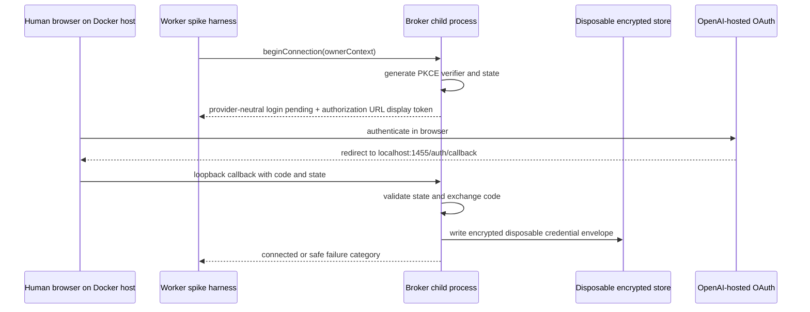

# Codex Direct OAuth Security Design

Task: T197
Date: 2026-07-31
Status: Security design and threat model for the direct Codex OAuth compatibility spike.

## 1. Executive Summary

T198 may proceed only as a disposable local compatibility spike. The selected
T198 topology is an isolated worker-side broker child process using stdio or a
Unix-domain socket, a loopback-only callback on the Docker host, a disposable
encrypted credential store, synthetic data only, and no production credential
persistence.

This is a **CONDITIONAL GO** for T198. The condition is narrow: browser and
Docker host must be the same machine, the callback must be loopback-only, the
store must be disposable, and the rest of Nuvitae must remain token-blind. This
does not authorize production integration, T199 production key management,
T200 backend invocation, T201 semantic parsing, T203 production approval, or
T164-T165.

The potential production self-hosted architecture should favor a dedicated
Docker broker service with a separate Unix identity, private credential volume,
internal authenticated interface, minimal image, restrictive container profile,
and no PostgreSQL or queue access unless a future architecture explicitly proves
the need. Remote or headless installations should not use a browser
`localhost:1455/auth/callback` assumption; they require a local helper, manual
paste strategy, SSH port forwarding, or a short-lived authenticated relay with
strict constraints.

## 2. Scope

In scope:

- credential-broker topology comparison;
- threat model for OAuth codes, PKCE, state, tokens, credential storage,
  account identifiers, resume text, provider responses, callback requests, logs,
  and backups;
- local and remote callback reachability analysis;
- conceptual credential-store, key-management, refresh, deletion, SSRF,
  authorization, hardening, logging, clean-room, and supportability design;
- objective entry gate for T198.

Out of scope:

- OAuth login;
- callback listener implementation;
- provider credential access, exchange, refresh, persistence, import, deletion,
  or migration;
- Codex backend invocation;
- production application code changes;
- production key-management implementation;
- production Codex adapter implementation.

## 3. Evidence Basis

Primary upstream evidence is
`docs/research/codex-direct-oauth-upstream-audit.md` from T196. It records:

- OpenClaw at `4c331166c40cccb6e4d2da1136c921faed1cc8c1`, MIT;
- Hermes Agent at `5d6aae02bffa7714c4a94f3a0900b37774442dea`, MIT;
- official OpenAI Codex source at
  `3016671bb077c43448b8fa88f3edfa9772e17058`, Apache-2.0;
- official OpenAI Codex docs observed on 2026-07-31.

T196 establishes that related open-source projects implement compatible OAuth
and transport behavior, and that some mechanics are visible in official Codex
source. It does not establish that direct third-party reuse is an officially
supported, stable OpenAI API.

Additional project evidence:

- `specs/001-import-resume/spec.md`;
- `specs/001-import-resume/plan.md`;
- `specs/001-import-resume/research.md`;
- `specs/001-import-resume/data-model.md`;
- `specs/001-import-resume/contracts/import-resume.md`;
- `specs/001-import-resume/quickstart.md`;
- `specs/001-import-resume/tasks.md`;
- `docs/research/codex-app-server-go-no-go.md`.

## 4. Protected Assets

| Asset | Owner | Trust boundary |
| --- | --- | --- |
| Access token | Broker only | Broker memory and encrypted credential store |
| Refresh token | Broker only | Broker memory and encrypted credential store |
| Authorization code | Broker only during exchange | Callback ingress to broker token exchange |
| PKCE verifier | Broker only | Broker memory and pending-login state |
| OAuth state | Broker only | Browser redirect to broker callback validation |
| Encryption master key | Deployment secret owner and broker process | Secret delivery boundary into broker |
| Encrypted credential record | Broker only | Private credential volume or broker store |
| Account identifier | Broker only when required for provider transport; safe partial status may be exposed | Broker transport boundary |
| Connection identifier | Nuvitae and broker | Provider-neutral application boundary |
| Synthetic resume text | Spike harness and broker invocation path after T200 only | Source-preparation to provider boundary |
| Future real resume text | Import pipeline and broker invocation path after production approval only | Private source storage to provider boundary |
| Provider response | Broker until translated to provider-neutral result | Provider transport to broker boundary |
| Callback request | Broker callback handler only | Browser loopback to broker boundary |
| Diagnostic logs | Observability system | Log write boundary with allowlist redaction |
| Backups | Deployment operator | Backup storage and restore boundary |

All token-bearing assets are broker-owned. The web application, browser
storage, public API responses, API controllers, resume-import domain,
provider-independent contracts, regular worker job payloads, PostgreSQL domain
entities, queue payloads, semantic extraction responses, and normal logs remain
token-blind.

## 5. Threat Actors And Failure Sources

Modeled actors and failure sources:

- malicious unauthenticated network client;
- authenticated tenant attempting cross-tenant access;
- compromised web process;
- compromised API process;
- compromised regular worker;
- compromised broker process;
- malicious or vulnerable dependency;
- local unprivileged host user;
- host administrator;
- container escape;
- stolen backup;
- accidental log disclosure;
- SSRF;
- callback interception;
- callback replay;
- OAuth state mismatch;
- refresh race;
- stale credentials;
- corrupted credential store;
- process crash during credential rotation;
- unsupported upstream protocol change.

## 6. Trust Boundaries

```text
Browser
  -> loopback callback only during pending login
  -> broker callback boundary
  -> broker token exchange boundary
  -> encrypted broker credential store
  -> broker provider transport boundary
  -> provider-neutral broker result
  -> worker provider adapter
  -> Nuvitae schema, grounding, review, and recovery
```

Important negative boundaries:

- the browser must not receive tokens, PKCE verifier, raw state value after
  creation, credential records, or provider-native auth responses;
- API controllers must not parse callback query strings or exchange codes;
- regular worker job payloads must not contain tokens, full auth URLs, callback
  URLs, account identifiers, or provider-native auth objects;
- PostgreSQL domain entities may store connection state and connection ids, not
  plaintext credentials or encrypted credential envelopes;
- normal logs may contain only allowlisted metadata.

## 7. Data-Flow Diagrams

T198 local login proof, bounded environment:



Provider invocation after later gates, not T197:

```text
Regular worker job contains import id and connection id only
  -> adapter asks broker to parseResume(connection id, provider-neutral source)
  -> broker attaches tokens internally and calls allowlisted provider transport
  -> broker strips provider-native response
  -> adapter returns provider-neutral extraction result or safe failure category
```

## 8. Topology Comparison

| Criterion | A. Dedicated Docker broker service | B. Isolated worker-side child process | C. Local helper plus server-side broker |
| --- | --- | --- | --- |
| Isolation | Strongest service/process/container boundary | Good process boundary, weaker shared-container boundary | Split boundary; helper adds local user-machine boundary |
| Token ownership | Clear: service-only | Clear if child process has private env, fd, and store | Server broker owns tokens; helper must never receive tokens |
| Callback fit | Good for local Docker host; needs port binding/relay | Good for local T198; child can own callback lifecycle | Best for remote/headless when helper is on browser machine |
| Network exposure | Internal broker API plus outbound provider traffic | No inbound service needed except temporary callback | Helper channel creates added attack surface |
| Filesystem separation | Private Docker volume and separate Unix identity | Possible, but shared namespace increases risk | Server broker store isolated; helper should be stateless |
| Lifecycle | Explicit service health and resource limits | Supervised by worker adapter; simpler spike lifecycle | Two-component install, upgrade, and compatibility burden |
| Resource limits | Strong Docker limits | Process limits plus shared container limits | Server broker plus helper limits |
| Operational burden | Moderate for self-hosting | Low for T198 spike | High for non-technical onboarding |
| Production suitability | Best default for self-hosted production | Possible for small single-user self-hosting | Useful remote/headless strategy, not default |
| Main risk | Internal API must be authenticated and locked down | Compromised worker/container can attack broker IPC/store | Helper distribution, update, trust, and channel security |

Do not automatically copy OpenClaw or Hermes architecture. Their behavior is
evidence for feasibility, not the target trust model.

## 9. Recommended T198 Topology

Use **B. isolated worker-side child process** for T198 only.

Required T198 constraints:

- spawned and supervised by a worker-side spike harness;
- stdio or Unix-domain socket IPC;
- no public general-purpose HTTP API;
- temporary loopback callback on `127.0.0.1:1455` only;
- browser and Docker host are the same machine;
- no inbound network service except the pending-login callback;
- disposable encrypted credential store in a private temporary path or Docker
  volume;
- no production credential persistence;
- no PostgreSQL, Valkey, private resume-storage, repository secrets, Docker
  socket, or host home mount;
- synthetic-only sentinel tests;
- explicit cleanup after success, cancellation, timeout, or failure.

This topology is narrower than the recommended production topology because T198
only needs to prove local callback compatibility and token-blindness.

## 10. Potential Production Topology

For single-user self-hosted production, prefer **A. dedicated Docker broker
service**:

- separate container and separate Unix identity;
- private credential volume mounted only into the broker;
- internal authenticated interface exposed only to allowed Nuvitae services;
- no public callback endpoint by default;
- no Docker socket, host home, repository, PostgreSQL, Valkey, or private resume
  storage mount unless a later design proves a specific need;
- minimal image and dependency set;
- read-only root filesystem with one writable private credential mount;
- dropped Linux capabilities, `no-new-privileges`, resource limits, and health
  checks that reveal no credential state.

For remote or headless installations, production likely needs either a local
authentication helper or a constrained manual/relay flow. That should be
designed after T198 proves local compatibility and after T199 proves safe
credential lifecycle behavior.

## 11. Callback And Deployment-Mode Analysis

| Deployment mode | Can browser `localhost:1455/auth/callback` reach broker? | Acceptable strategy |
| --- | --- | --- |
| Local Docker Desktop, browser and Docker host same machine | Yes, if the broker callback is published or bridged only on host loopback | T198 supported mode: loopback callback directly to local Docker host |
| Home server or NAS accessed from another computer | No. Browser localhost is the user's computer, not the server | Use local helper, SSH port forwarding by technical users, manual paste, or short-lived authenticated relay |
| Remote VPS/server installation | No. Browser localhost is not the VPS | Use local helper, SSH port forwarding, manual paste, or short-lived authenticated relay |
| Headless Docker host without browser | No browser on host | Use device/manual flow if supported later, local helper on another machine, SSH forwarding, or relay |

Strategy evaluation:

- Loopback callback directly to the local Docker host: selected for T198 only.
  Bind to `127.0.0.1`, fixed path, pending-login lifetime, bounded request
  size, and immediate teardown.
- Manual paste of full redirect URL or authorization result: acceptable only if
  the broker validates state and extracts the code without logging or storing
  the full URL. Usability is weak but useful for remote technical users.
- Local companion/helper process: viable for remote/headless production if the
  helper receives only the browser callback and transfers a minimum one-time
  result through an authenticated, encrypted, bounded channel. The helper must
  not store tokens or receive refresh tokens.
- Short-lived authenticated relay: possible only with proof of authentication,
  CSRF protection, state binding, expiry, bounded payloads, replay prevention,
  and no public unauthenticated callback. It adds operational and product risk.
- Public callback endpoint: rejected for T198 and not selected for production
  convenience. It could be considered only with strong authentication, exact
  state binding, ownership binding, rate limits, replay defenses, and explicit
  product/security approval.
- Host networking: rejected as a default. It broadens exposure and is
  platform-dependent. Use only as a controlled diagnostic if loopback publishing
  cannot work.
- SSH port forwarding: acceptable for technical remote users because it keeps
  callback reachability private, but it is not suitable for non-technical
  onboarding as the primary path.

Exact T198 supported test environment:

```text
Local Docker Desktop or equivalent local Docker engine.
Human browser and Docker host are the same machine.
Broker callback is reachable only through 127.0.0.1:1455/auth/callback.
No claim of remote, NAS, VPS, or headless compatibility.
```

## 12. Credential Ownership

Only the broker may possess:

- OAuth authorization codes while exchanging them;
- PKCE verifiers;
- OAuth state values;
- access tokens;
- refresh tokens;
- provider account identifiers required for transport;
- encrypted credential records.

Nuvitae may receive only:

- connection identifier;
- connected, disconnected, reconnect-required, or deleted state;
- provider availability;
- safe failure category;
- semantic parsing success or failure.

The broker must derive owner authorization from trusted caller identity, not
from caller-provided owner ids alone.

## 13. Credential-Store Design

Conceptual store requirements:

- authenticated encryption at rest;
- explicit key version;
- per-record nonce;
- owner or connection identity bound as authenticated associated data;
- one credential namespace per Nuvitae owner;
- restrictive filesystem permissions;
- dedicated private volume;
- atomic write and replace;
- crash-safe rotation with previous-generation recovery;
- no plaintext tokens in PostgreSQL, logs, queues, browser storage, image
  layers, fixtures, Git, or unencrypted backups.

Conceptual encrypted credential envelope:

| Field | Purpose |
| --- | --- |
| envelopeVersion | Format migration and fail-closed parsing |
| providerConnectionId | Provider-neutral connection lookup |
| ownerAssociatedData | Bound as AEAD associated data, not trusted from ciphertext |
| encryptedTokenPayload | Access token, refresh token, transport-required account id |
| accessTokenExpiresAt | Lifecycle and refresh decision |
| accountIdentifierStatus | Present, absent, or unavailable; full value stays encrypted if needed |
| createdAt / updatedAt | Lifecycle audit without token data |
| credentialGeneration | Compare-and-swap rotation and crash recovery |
| keyVersion | Master-key selection and rotation planning |

Raw provider credentials must not appear in public contracts or domain entities.

## 14. Key-Management Comparison

| Option | Local development | Single-user self-hosting | Future multi-user hosting |
| --- | --- | --- | --- |
| Docker secret or read-only mounted secret file | Good; reproducible and not in image | Minimum acceptable for T199/self-hosting | Acceptable only with rotation and secret distribution controls |
| Environment variable | Convenient but leaks through process inspection, dumps, and config mistakes | Acceptable only as a fallback with warnings | Weak; avoid for hosted multi-user |
| Host keychain integration | Strong for desktop installs | Platform-specific and hard inside Docker | Poor fit for server multi-tenancy |
| Generated local secret file | Useful disposable default if permissions are strict | Acceptable for single-user with backup warning | Weak without central rotation/escrow |
| External secret manager | Overkill for T198/T199 | Optional advanced self-hosting | Preferred for hosted multi-user |

Minimum acceptable T199 strategy: a Docker secret or read-only mounted secret
file for the master key, plus a disposable generated secret-file fallback for
local development only. T197 does not implement production key management.

## 15. Credential Lifecycle

Lifecycle states:

```text
not_configured -> login_pending -> connected
login_pending -> login_cancelled | failed
connected -> auth_expired | auth_revoked | unavailable | disconnected | deleted
auth_expired/auth_revoked/disconnected -> login_pending -> connected
```

Rules:

- pending login state expires and is deleted on timeout;
- authorization code is exchanged once and cleared from memory immediately after
  exchange attempt;
- encrypted credential write succeeds atomically before `connected` is reported;
- rotation writes a new generation and then retires the previous generation;
- deletion removes encrypted records, clears memory, stops refresh, invalidates
  connection status, and prevents use after restart.

## 16. Refresh And Concurrency

Refresh design:

- refresh on access-token expiry or a narrowly authorized auth-failure category;
- do not treat every 401 or 403 as token expiry;
- never refresh on quota, subscription, malformed request, provider unavailable,
  timeout, or policy errors;
- use a per-owner/per-connection single-flight lock;
- re-read current credential generation before refresh;
- compare-and-swap encrypted credential replacement;
- support rotated refresh tokens and preserve old generation only until the new
  generation is durably written;
- if the process crashes during refresh, recover by selecting the newest valid
  complete generation and marking uncertain state as reconnect-required if
  ambiguity remains;
- `invalid_grant`, revoked credentials, stale refresh tokens, or repeated
  single-use refresh-token reuse become reconnect-required;
- bounded retries with jitter and cancellation;
- refresh-loop prevention through attempt counters, cooldowns, and terminal safe
  failure categories.

## 17. Logout, Revocation, And Deletion

Distinctions:

- deleting local credentials: remove encrypted broker records and prevent future
  local use;
- ending local broker session: clear memory and pending login/refresh state;
- remote token revocation: only claim support after audited evidence verifies a
  supported revocation endpoint or operation;
- disconnecting Nuvitae from provider: provider-neutral state transition that
  does not delete resumes or import drafts;
- deleting provider connection record: removes Nuvitae connection metadata after
  local credential deletion has completed or is already absent.

Local deletion requirements:

- remove encrypted credential records;
- clear in-memory token material as far as the runtime allows;
- stop future refresh;
- invalidate local connection;
- prevent use after restart;
- produce only privacy-safe audit metadata.

Language-runtime memory cannot generally guarantee perfect zeroization.

## 18. Network And SSRF Policy

Future broker allowlists must distinguish:

- OpenAI authorization host;
- OpenAI token host;
- ChatGPT Codex transport host;
- exact permitted paths for authorization, token exchange/refresh, and selected
  transport.

Controls:

- HTTPS only for provider endpoints;
- exact host allowlist;
- exact or bounded path allowlist;
- no embedded credentials in URLs;
- no arbitrary base URL;
- no redirects to unapproved hosts;
- DNS rebinding considerations by resolving and validating target host per
  request and not accepting caller-supplied hosts;
- bounded response size;
- connection timeout and request timeout;
- cancellation;
- privacy-safe errors;
- no response-body logging for authentication endpoints.

T197 does not implement the transport.

## 19. Broker Interface

Provider-neutral conceptual operations:

- `beginConnection(connectionId)`;
- `getConnectionStatus(connectionId)`;
- `completeConnection(connectionId, callbackResult)` only for manual/helper
  strategies that require it;
- `reconnect(connectionId)`;
- `disconnect(connectionId)`;
- `deleteConnection(connectionId)`;
- `parseResume(connectionId, providerNeutralSource)`;
- `cancelInvocation(invocationId)`.

The interface must not expose:

- access token;
- refresh token;
- authorization code;
- PKCE verifier;
- OAuth state;
- provider-native credential object;
- raw authentication response.

Prefer internal authenticated IPC or a private internal service interface. Do
not expose a public general-purpose HTTP API.

## 20. Authorization Model

Allowed callers:

- worker-side provider adapter: `getConnectionStatus`, `parseResume`,
  `cancelInvocation`;
- internal provider-connection service: `beginConnection`, `reconnect`,
  `disconnect`, `deleteConnection`;
- callback/helper completion component: only `completeConnection` for a pending
  login that it can prove by channel binding and state ownership.

Controls:

- broker authorizes based on trusted service identity and connection ownership;
- caller-provided owner ids are advisory and must be checked against an
  authenticated internal principal;
- connection ids must be unguessable;
- operations are idempotent where possible;
- forbidden responses never reveal account identity or another owner's state.

## 21. Multi-User Isolation

Requirements:

- one credential namespace per owner;
- unguessable connection identifiers;
- broker authorization independent of caller-provided owner ids;
- per-owner/per-connection refresh locks;
- per-owner deletion;
- backup separation or backup metadata that permits owner-scoped restore/delete;
- log isolation with no account emails, names, or complete account identifiers;
- future hosted multi-tenancy requires separate validation.

T198 status: **single-user only**. It may simulate owner binding with one owner
namespace but must not claim production tenant isolation.

## 22. Process And Container Hardening

Future broker container or child process controls:

- non-root user;
- read-only root filesystem;
- writable private credential mount only;
- no Docker socket;
- no host home mount;
- no repository mount unless a future spike proves strict necessity;
- no PostgreSQL access unless architecture explicitly requires it;
- no Valkey access unless architecture explicitly requires it;
- dropped Linux capabilities;
- `no-new-privileges`;
- CPU, memory, process, fd, and temporary-storage limits;
- minimal environment allowlist;
- explicit outbound network allowlist where feasible;
- bounded child-process supervision and teardown;
- health checks that reveal no credential state.

## 23. Logging And Privacy

Allowlisted log fields:

- operation category;
- provider-neutral connection state;
- request correlation ID;
- safe failure category;
- duration;
- retry count;
- response status category where safe.

Prohibited log fields:

- complete authorization URL;
- authorization code;
- OAuth state;
- PKCE verifier;
- access token;
- refresh token;
- cookies;
- complete account identifier;
- email;
- user name;
- resume text;
- provider response body.

Require synthetic sentinel secret-scanning tests for tokens, callback query
strings, state, PKCE verifier, account id, email-like values, and resume-like
text. Sentinel scans must cover repository files, spike evidence, stdout/stderr
captures, broker logs, worker logs, and persisted diagnostic artifacts.

## 24. Licensing And Clean-Room Boundary

T196 found OpenClaw and Hermes under MIT and official OpenAI Codex source under
Apache-2.0. No implementation code was copied for T197.

Clean-room approach:

- document behavior and protocol facts with source references and evidence
  classifications;
- write Nuvitae code for Nuvitae's own broker topology, storage, interface, and
  trust boundaries;
- do not copy verbatim upstream implementation;
- preserve required notices if code is ever adapted later;
- maintain an inventory of derived behavior and source references.

## 25. Supportability And Product Risk

Technical feasibility: open-source projects implement related flows and official
source verifies several first-party mechanics.

Security feasibility: plausible only with a dedicated broker, encrypted store,
strict callback constraints, SSRF allowlists, refresh serialization, token-blind
application boundaries, and log sentinel tests.

Official supportability: **unverified**. Third-party reuse of the direct Codex
OAuth/client/backend behavior is not documented as a stable public OpenAI API.

Product onboarding feasibility: local Docker same-machine login is feasible for
a spike, but remote/headless/non-technical onboarding remains unresolved.

Operational stability: protocol, headers, originator behavior, account-id
claims, backend paths, quota behavior, and error formats may change without
public deprecation guarantees.

A technically successful T198 may still lead to CONDITIONAL GO or NO-GO at T203.

## 26. Threat Register

| Threat | Affected asset | Scenario | Boundary crossed | Likelihood | Impact | Preventive controls | Detective controls | Recovery controls | Residual risk | Production disposition |
| --- | --- | --- | --- | --- | --- | --- | --- | --- | --- | --- |
| Unauthenticated callback probing | Callback request, authorization code | Network client sends fake callback | Network to broker | Medium | High | Loopback bind, pending-login only, state validation, path allowlist | Callback attempt counters, safe failure logs | Cancel pending login, teardown listener | Low local, medium if exposed | Required controls before T198 |
| Callback replay | Authorization code, OAuth state | Attacker reuses prior callback URL | Browser/callback to broker | Medium | High | Single-use state, expiry, code exchange once, no callback persistence | Replay counter by login id | Invalidate pending login, reconnect | Low | Required controls |
| OAuth state mismatch | OAuth state | Returned state differs | Browser to broker | Medium | High | Constant-time comparison where practical, state bound to connection | Safe mismatch category | Delete pending login | Low | Required controls |
| Callback interception | Authorization code | LAN/public binding lets another host observe callback | Network to broker | Medium | Critical | Bind `127.0.0.1`, reject `0.0.0.0`, no public endpoint | Port binding validation | Abort login and cleanup | Low for T198 | Public unauthenticated callback rejected |
| Compromised web process | Connection id | Web tries to fetch tokens or auth details | Web/API to broker | Medium | High | Web never talks to broker; API returns provider-neutral state only | Contract tests and secret scans | Rotate/delete credentials if boundary broken | Medium | Token-blind web required |
| Compromised API process | Tokens, encrypted records | API calls broker with forged owner id | API to broker | Medium | Critical | Internal auth, broker-side authorization, unguessable ids | Broker audit metadata | Delete affected connection, rotate key if needed | Medium | Must be validated before production |
| Compromised regular worker | Tokens, provider response | Worker attempts broker abuse or reads store | Worker to broker/store | Medium | Critical | IPC auth, private volume not mounted to worker, operation allowlist | Invocation anomaly logs | Delete connection, revoke locally, rebuild worker | Medium | Dedicated service preferred for production |
| Compromised broker process | All broker-owned credentials | Broker memory or store exposed | Broker internal boundary | Low | Critical | Minimal image, hardening, least privilege, no extra mounts | Health/anomaly logs, secret scans cannot fully detect | Delete credentials, rotate master key, reauth | High | Accepted only with operational controls |
| Malicious dependency | Tokens, logs, provider response | Dependency exfiltrates memory or logs | Process dependency boundary | Medium | Critical | Minimal deps, pinned versions, audit, no arbitrary plugins | Dependency scanning, outbound allowlist | Rebuild, rotate credentials/key | Medium | Minimize dependency set |
| Local unprivileged host user | Encrypted store, master key | Reads mounted files or temp dirs | Host filesystem boundary | Medium | High | Owner-only permissions, Docker volume, secret file mode | Permission validation | Rotate key and reconnect | Medium | Required for T199 |
| Host administrator | All assets | Admin reads memory, volumes, backups | Host trust boundary | Medium | Critical | Document trust assumption, encryption at rest helps backups only | Limited | Rotate after host trust restored | High | Residual accepted for self-hosting |
| Container escape | Tokens, store, network | Process escapes broker container | Container to host | Low | Critical | No-new-privileges, dropped caps, read-only root, no Docker socket | Runtime security alerts where available | Rebuild host, rotate all credentials | High | Production hardening required |
| Stolen backup | Encrypted records, resume text | Backup copied from host/cloud | Backup boundary | Medium | Critical | Encrypted credentials, no unencrypted credential backups | Backup inventory and restore tests | Rotate master key and credentials | Medium | Unencrypted credential backups forbidden |
| Accidental log disclosure | Tokens, auth URL, resume text | Callback URL or provider body logged | Process to logs | Medium | Critical | Allowlist logging, redaction, no body logs | Sentinel secret scans | Purge logs, rotate credentials | Medium | Sentinel tests required |
| SSRF | Token endpoint, provider response | Caller supplies arbitrary URL/base URL | Broker request boundary | Medium | Critical | Exact host/path allowlist, no redirects, no embedded creds | Rejected URL metrics | Fail closed | Low | Required before T200 |
| Refresh race | Refresh token | Concurrent refresh reuses single-use token | Broker concurrency boundary | High | High | Per-connection lock, re-read, CAS generation | Refresh conflict logs | Mark reconnect-required | Medium | T199 must prove |
| Stale credentials | Access/refresh token | Expired or rotated token repeatedly used | Store to provider | Medium | High | Expiry tracking, authorized refresh categories | Repeated auth failure counters | Reconnect-required, cleanup | Medium | T199 must prove |
| Corrupted credential store | Encrypted record | Partial write or tampering breaks decrypt | Store boundary | Medium | High | AEAD, atomic replace, key version, generation | Integrity failure logs | Restore previous generation or reconnect | Low | Required |
| Crash during rotation | Refresh token, encrypted record | Process dies after token exchange before durable write | Broker/store boundary | Medium | High | Write-ahead generation, CAS, fsync where available | Startup recovery check | Use newest valid complete generation or reconnect | Medium | T199 must prove |
| Unsupported upstream change | Auth endpoints, transport, headers | Provider behavior changes silently | Broker/provider boundary | High | High | Exact allowlists, versioned behavior inventory, fail closed | Safe category metrics | Disable provider, T203 reevaluation | High | Major residual risk |
| Account id leakage | Account identifier | Logs/API expose email/name/full id | Broker to app/logs | Medium | Medium | Partial/redacted status only, no profile claims in API | Log scans | Purge logs | Low | Required |
| Cross-owner access | Credential namespace | Tenant guesses connection id | App/broker boundary | Medium | Critical | Unguessable ids, owner-bound AAD, broker auth | Forbidden counters | Delete affected namespace | Medium | Not production-validated in T198 |
| Provider response leakage | Provider response, resume text | Raw body logged or persisted | Provider to broker/logs | Medium | Critical | No response-body logging, translate before return | Sentinel and body-size checks | Purge, rotate if auth data leaked | Medium | Required before T200 |
| Quota error refresh loop | Refresh token | 429/quota triggers repeated refresh | Provider error to refresh boundary | Medium | Medium | Refresh only on authorized categories, retry budget | Retry/refresh counters | Cooldown and safe failure | Low | Required |
| Public relay abuse | Callback request | Relay accepts unauthenticated internet traffic | Internet to relay | Medium | Critical | Not selected for T198; future relay must be authenticated and short-lived | Relay access logs without query data | Disable relay | Medium | Needs separate design |

## 27. Residual Risks

- Official third-party support remains unverified.
- Host administrators can access process memory and alter deployment inputs.
- Language runtimes cannot guarantee perfect token zeroization.
- Multi-user tenant isolation is not production-proven by T198.
- Remote/headless onboarding is unresolved for non-technical users.
- Provider backend, headers, account claims, and errors may change without stable
  third-party API guarantees.

## 28. T198 Entry Gate

Prerequisites for starting T198:

- selected spike broker topology: isolated worker-side broker child process;
- selected local callback topology: loopback-only `127.0.0.1:1455/auth/callback`;
- exact supported deployment mode: local Docker host and browser on the same
  machine;
- trust boundaries documented in this report;
- token ownership documented as broker-only;
- disposable credential store design documented;
- safe cleanup procedure required for pending login, callback listener, memory,
  and disposable store;
- no production credential persistence;
- exact host and path allowlists defined before any network call;
- logging allowlist defined;
- secret-scanning strategy using synthetic sentinels;
- timeout and cancellation limits for pending login, callback wait, token
  exchange, and cleanup;
- failure cleanup behavior defined;
- no T198 code may invoke the Codex backend or send resume text.

Decision: **CONDITIONAL GO** for T198 as a disposable compatibility spike only.

## 29. Unresolved Questions

1. Will OpenAI document or otherwise authorize third-party direct Codex OAuth and
   backend reuse?
2. Which exact scopes and originator parameters are acceptable for Nuvitae
   without impersonating first-party clients?
3. Can a non-technical remote/headless self-hosted user complete login without a
   helper or unsafe public callback?
4. What hosted multi-user secret manager and tenant isolation model would be
   required if Nuvitae later offers managed hosting?
5. Can provider token revocation be supported through an audited official
   endpoint, or is local deletion the only proven disconnect operation?
6. What semantic parsing quality and operational metrics will T201-T202 produce
   if T198-T200 succeed?

## 30. Evidence Classification

| Claim | Classification |
| --- | --- |
| OpenClaw and Hermes implement related direct Codex OAuth/transport behavior | Open-source compatibility behavior from T196 |
| Official Codex source contains client id, auth hosts, loopback callback behavior, token host, and direct Codex backend mechanics | Behavior verified from official source code in T196 |
| Codex product sign-in exists for official Codex products | Officially documented OpenAI behavior from T196 |
| Third-party direct OAuth reuse is stable and supported | Unverified; not established |
| Dedicated broker is required for Nuvitae token-blindness | Nuvitae architecture decision from spec/plan/research |
| T198 can safely test local same-machine loopback callback | Design inference requiring bounded validation |
| Production self-hosted broker should be a dedicated Docker service | Recommendation from this threat model |
| Remote/headless browser localhost reaches the server | Rejected; false for remote deployments |
| T198 authorizes production Codex adapter work | Rejected; T164-T165 remain blocked |
